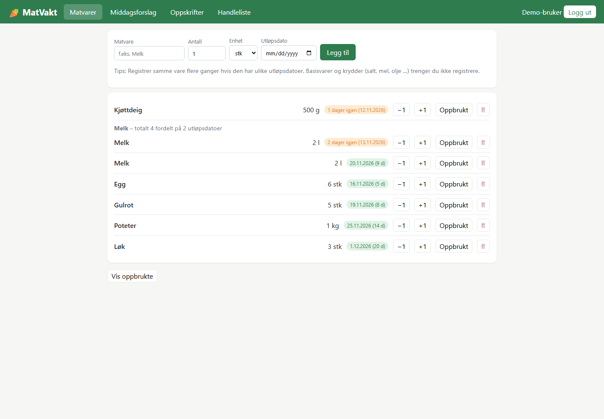
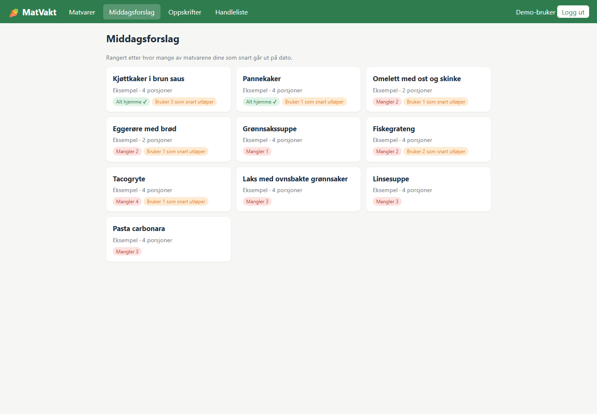
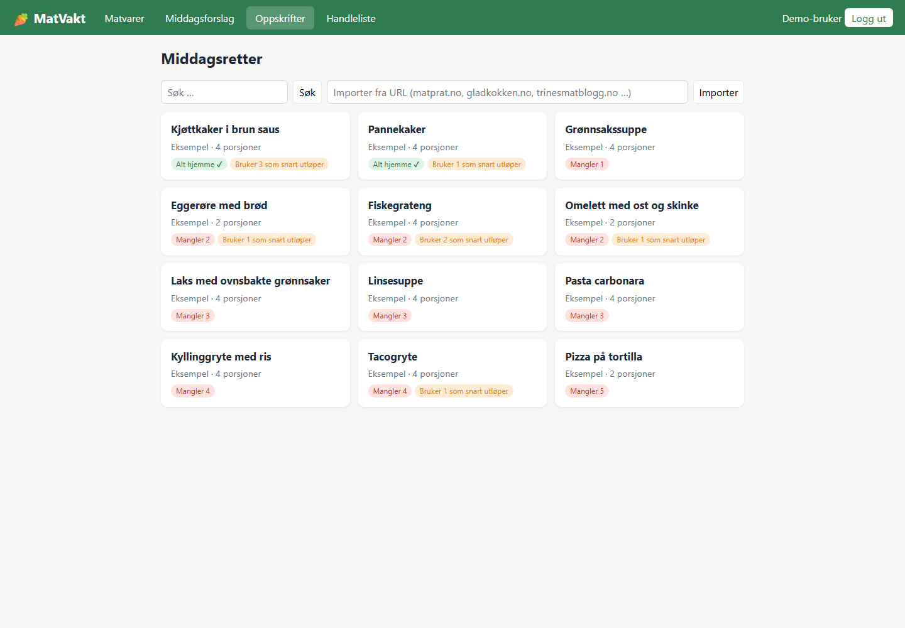

# MatVakt

En norsk webapp for matvarer, utløpsdatoer, middagsforslag og handleliste. Bygget med ASP.NET Core og Entity Framework Core på .NET 10, SQLite og JavaScript/CSS uten eget frontend-bygg.

## Funksjoner

- Registrer matvarer med mengde, enhet og utløpsdato, og marker oppbrukte varer.
- Få middagsforslag ut fra ingrediensene du har hjemme.
- Bla i oppskrifter og importer fra støttede oppskriftsnettsider.
- Samle manglende ingredienser på en handleliste.
- Bruk Google-innlogging eller den innebygde demoen med eksempelvarer.

## Kjør lokalt

Krever .NET 10 SDK og NuGet-tilgang ved første bygg. Kjør fra prosjektmappen:

```powershell
Copy-Item appsettings.example.json appsettings.json
dotnet run --urls http://localhost:5180
```

Åpne [localhost:5180](http://localhost:5180). Når `Google:ClientId` ikke er satt, kan du velge **Fortsett med demo-innlogging**. Den oppretter en lokal demobruker med eksempelvarer. Oppskriftsbiblioteket fylles ved første oppstart.

## Eksempelbilder

Bildene er fra demo-innlogging i en separat lokal database, uten ekte brukerdata.







## Konfigurasjon og data

- `Google:ClientId`: klient-ID for Google Identity Services. Sett den med miljøvariabelen `Google__ClientId` og registrer appens origin i Google-oppsettet. Når verdien er satt, deaktiveres demo-innlogging.
- `ConnectionStrings:Default`: SQLite-tilkobling. Standard er `Data Source=matvakt.db` i prosjektets arbeidsmappe. Kan overstyres med `ConnectionStrings__Default`.

Bare den rensede `appsettings.example.json` ligger i Git. Lokale appsettings-filer, databaser, `.env`, token-/nøkkelfiler og byggeutdata utelates. Databasen inneholder brukerdata og skal sikkerhetskopieres separat. Innlogging bruker cookies; bruk HTTPS ved ekstern hosting. Import av oppskrifter og Google-innlogging trenger nettverk; eksterne oppskriftssider kan endre format.

## Bygg og kontroll

```powershell
dotnet build MatVakt.csproj -c Release
```

Prosjektet har ingen separat testpakke. Kontroller demo-innlogging, matvarelisten, middagsforslag og oppskriftsvisning lokalt før utrulling.

Bygg og disse fire visningene er kontrollert lokalt 11. november 2026 med separat database. Ekte Google-innlogging og import fra eksterne oppskriftssider er ikke verifisert i denne kontrollen.
